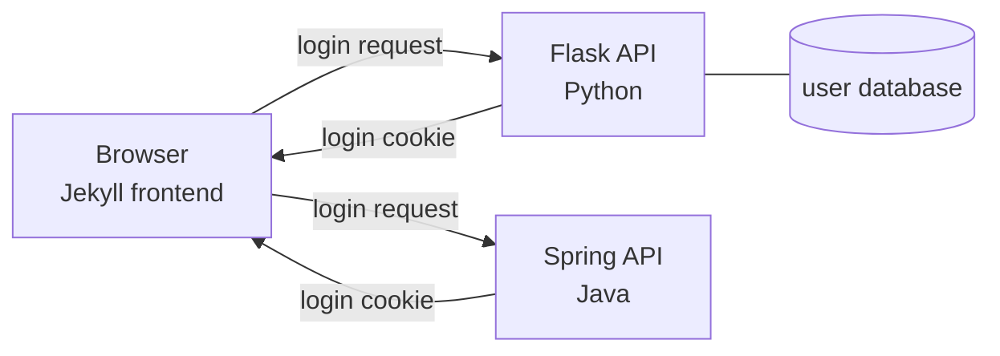
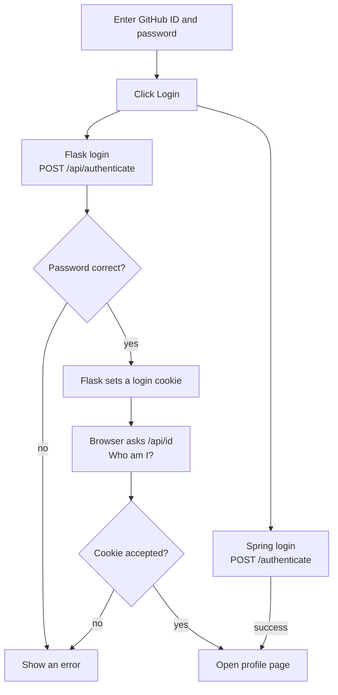
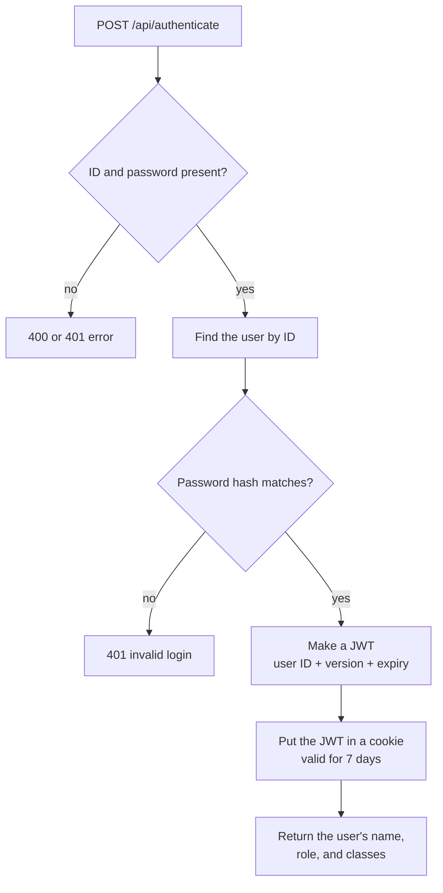
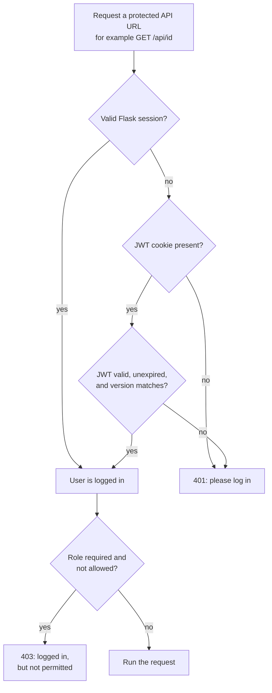

Open Coding Society

<h1 class="ocs__section-title">{{ page.title }}</h1>

{{ page.description }}

Logging in answers two questions:

1. **Who are you?** The server checks your ID and password.
2. **How does the site remember you?** The server gives the browser a cookie, and the browser sends that cookie back on later requests.

A useful comparison is a wristband at an event: you show your ID once, get a wristband, and later staff only check the wristband. The cookie is the wristband.

## Words used on this page

- **Frontend** — the web pages you see, built with Jekyll.
- **Backend** — the server that stores users and checks passwords. This project has a **Flask** backend (Python) and a **Spring** backend (Java).
- **API** — a URL the frontend calls to send or receive data, such as `/api/authenticate`.
- **GET, POST, DELETE** — request methods. GET asks for data, POST sends data, DELETE removes something.
- **Cookie** — a small note the browser stores and sends automatically.
- **Origin** — a site's address, such as `https://example.com`. Browsers treat different origins as separate security zones.
- **JWT** — a signed note from Flask. It contains your user ID, a version number, and an expiry time. Because it is signed, the browser cannot change it without the server noticing.
- **Session** — login state kept on the server, with a session cookie used to look it up.
- **Hash** — a one-way scramble of a password. The database stores the hash, not the real password.
- **`token_version`** — a counter on the user record. It goes up when the password changes, which cancels old logins.

## 1. The players

The login page is a Jekyll page, but it calls two servers. The Python and Java logins start at the same time. This page explains the Flask side in detail because that is the code in `rotary-backend`.

## 2. Pressing Login

The Spring branch is separate. If the Spring login fails, the page tries to create a Spring account and then logs in again. That is why a failed Java login may still end with a new account rather than an error.

On the Flask path, after the login succeeds, the browser calls `/api/id` to prove the cookie works. If that check passes, it opens the profile page.

## 3. What Flask does with the password

The password is never stored as plain text. When the account is created, Flask stores a hash. On login, it hashes the typed password and compares the two. A wrong password gets a **401**, which means "not authenticated".

The JWT is signed with the server's `SECRET_KEY`. If someone edits the user ID inside it, the signature check fails and the server rejects it.

## 4. How later requests stay logged in

Flask accepts **either** a Flask session or a JWT cookie. It also accepts a token in an `Authorization: Bearer ...` header. The check lives in `api/authorize.py` and is called `token_required`. A **401** means "I do not know who you are". A **403** means "I know who you are, but you are not allowed to do this".

The `token_version` comparison is the important part. If an admin resets your password, the version changes. Your old JWT or session still has the old version, so it stops working immediately instead of lasting until its 7-day expiry.

## The details that cause most login bugs

- **Cookies must be sent.** The frontend uses `credentials: 'include'`. Without it, the browser ignores the login cookie, and the next request acts as if you never logged in.
- **Production cookies are strict.** `Secure` means HTTPS only. `HttpOnly` means page JavaScript cannot read the cookie. `SameSite=None` lets the cookie travel between the site and the API. The domain `.opencodingsociety.com` shares it across subdomains. The server's CORS list decides which origins may make the request. In development the cookie is looser so local testing works.
- **The frontend and backend have different `/login` pages.** The Jekyll page at `/login` is the form you use. The Flask server also has a `/login` route for its own server-rendered pages. That Flask route creates a session, not a JWT. Normal API login uses `/api/authenticate`.
- **The Flask API login does not create a Flask session.** It only issues the JWT cookie. That is why the code supports both authentication methods.

## When login fails

| What you see | What it usually means |
| --- | --- |
| `Login error: 401` | Wrong ID or password. The helper only shows the number, not Flask's message. |
| Login succeeds, then `/api/id` returns 401 | The browser did not store or send the cookie. Check `credentials: 'include'`, the origin, and HTTPS. |
| 403 Forbidden | You are logged in, but your role is not allowed to use that URL. |
| Logged out after a password reset | Expected. The password change bumped `token_version`, so old cookies are invalid. |

## Where to look

**Frontend:** `navigation/authentication/login.md`, `assets/js/api/config.js`, `assets/js/api/login.js`, `assets/js/api/logout.js`.

**Backend:** `api/user.py` for `/api/authenticate` and `/api/id`; `api/authorize.py` for the login check; `main.py` for Flask's own `/login` and `/logout`; `model/user.py` for password hashing and `token_version`.

Logging out is the reverse: the frontend calls `DELETE /api/authenticate`, Flask replaces the JWT with an expired cookie, and Spring clears its own session.

